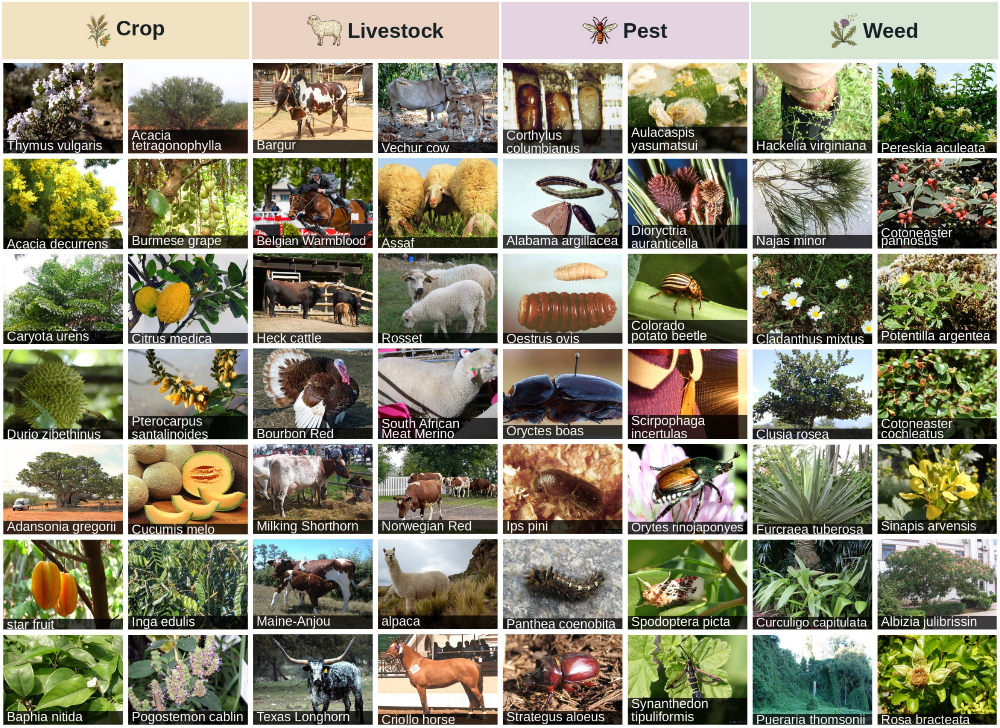

# AgriTaxon

**AgriTaxon: Knowledge-grounded benchmarking of open-ended agricultural entity naming with multimodal foundation models**

Xin Zeng, Benfeng Xu, Qian Chen, Qiang Wu, Wentao Zhang, Liguo Lang, Shancheng Fang, Huarui Wu

[🌐 Project page](https://studyzx.github.io/AgriTaxon/) · [🤗 Dataset](https://huggingface.co/datasets/Xin1818/AgriTaxon)

<p align="center">
  
</p>

## Abstract

Naming the organism in an image is the entry point to many agricultural decisions, from pesticide selection to breed management. Multimodal foundation models hold ever broader world knowledge, yet agriculture remains among their least evaluated domains. Its visual knowledge is fine-grained and long-tailed, with many regional species and breeds. We introduce AgriTaxon, a benchmark built from agricultural knowledge bases. Starting from the crops, breeds, pests, and weeds catalogued by FAO Ecocrop, FAO DAD-IS, and EPPO, it keeps 6,049 entities after filtering for image quality and entity validity. Each entity is linked through Wikidata, labeled at species level or finer, and evaluated in two settings: choosing its name among four options, and naming it without options. An LLM judge, validated against expert annotation, credits aliases. We comprehensively evaluate 17 proprietary and open-source models from eight providers. The best reach 85.8% multiple-choice accuracy but only 47.3% open-ended accuracy, and this seeing-without-naming gap remains after aliases are credited. The gap is harder to close for rare entities and field images. AgriTaxon-Hard isolates 510 entities that nearly all models fail. In AgriTaxon-Wild, one field image is about eight points less accurate for naming than the Wiki image, and only several images recover the loss. Naming accuracy rises with entity popularity and image resolution. A simple agentic loop with web retrieval already raises accuracy on AgriTaxon-Hard from 4.6% to 23.2%, making tool use a promising direction. Naming, which closed-set evaluation hides, thus remains the first threshold for applying foundation models in agriculture.

## Benchmark

| Setting | Entities | Images | Selection |
|---|---:|---|---|
| **AgriTaxon-Main** (default) | 6,049 | 6,049 Wiki images | Linked to FAO or EPPO; species level or finer |
| **AgriTaxon-Hard** | 510 | 510 Wiki images | At most 2 of 14 models correct in multiple choice |
| **AgriTaxon-Wild** | 2,826 | 14,130 field images | At least 5 iNaturalist field images |

Each entity of AgriTaxon-Main is shown by one Wiki image, its Wikimedia Commons image linked through Wikidata. AgriTaxon-Hard and AgriTaxon-Wild extend AgriTaxon-Main on its entities. The entities come from the agricultural knowledge bases that catalogue them, linked through Wikidata:

| Track | Entities | Knowledge base |
|---|---:|---|
| Crop | 1,960 | FAO Ecocrop |
| Livestock | 172 | FAO DAD-IS |
| Pest | 2,415 | EPPO Global Database |
| Weed | 1,502 | EPPO Global Database |

Every label is at species level or finer (for livestock, usually a breed), so a correct answer is always a name that the image can support.

## Evaluation

Each entity is evaluated in two settings:

- **Multiple-choice selection (MC):** the model chooses the label among four options; the three distractors are the labels nearest to the answer by text embedding.
- **Open-ended naming (OE):** the model states the name of the entity without options.

Metrics are **MC accuracy**, **OE-EM** (normalized exact match, a reproducible lower bound), and **OE-Acc**, which additionally credits aliases accepted by an open-weight LLM judge (Qwen3.8-Flash-Next, FP8 checkpoint, reasoning disabled, temperature 0). On a stratified sample of 579 predictions, the judge agrees with expert annotation on 97.8% (exact match: 92.8%). Summary scores are unweighted means over the four tracks.

## Main findings

- Across 17 models, the best reach 85.8% MC accuracy but only 47.3% OE-Acc. This seeing-without-naming gap remains for every model after aliases are credited, and it is widest for small and fast models.
- Entities with at most 100 monthly Wikipedia views are named by 1.82 of 17 models on average, against 12.08 above 10,000 views.
- On AgriTaxon-Wild, one field image is about eight points less accurate for naming than the Wiki image, and only several field images recover the loss.
- On AgriTaxon-Hard, in a simple agentic loop, web retrieval raises GPT-5 Mini from 4.6% to 23.2% MC accuracy, and image cropping raises Claude Haiku 4.5 from 7.2% to 15.2%.

The full leaderboard, examples, and analyses are on the [project page](https://studyzx.github.io/AgriTaxon/).

## Dataset

The data, model outputs, and judge verdicts are hosted on Hugging Face:

🔗 [Xin1818/AgriTaxon](https://huggingface.co/datasets/Xin1818/AgriTaxon)

```bash
pip install huggingface_hub
huggingface-cli download Xin1818/AgriTaxon --repo-type dataset --local-dir AgriTaxon
```

## Prompts

The evaluation prompt templates are in [`prompts/`](prompts/), and the prompts are also given in the appendix of the paper.

## Licensing and Access

- **Website code, prompt templates, and documentation:** [MIT License](LICENSE).
- **Benchmark annotations and metadata:** CC BY 4.0.
- **Wiki images (AgriTaxon-Main and AgriTaxon-Hard):** sourced from Wikimedia Commons and subject to their original licenses.
- **AgriTaxon-Wild images:** sourced from iNaturalist and subject to their per-photo licenses and attribution requirements; some licenses include NonCommercial or NoDerivatives restrictions.
- **Knowledge-base identifiers:** Wikidata QIDs are available under CC0; FAO and EPPO identifiers are used for reference linking only.

Users must consult the per-image license and attribution metadata distributed with the dataset before reuse.

## Citation

```bibtex
@misc{zeng2026agritaxon,
  title  = {AgriTaxon: Knowledge-grounded benchmarking of open-ended agricultural entity naming with multimodal foundation models},
  author = {Zeng, Xin and Xu, Benfeng and Chen, Qian and Wu, Qiang and Zhang, Wentao and Lang, Liguo and Fang, Shancheng and Wu, Huarui},
  year   = {2026},
  note   = {Under review},
  howpublished = {\url{https://huggingface.co/datasets/Xin1818/AgriTaxon}}
}
```
