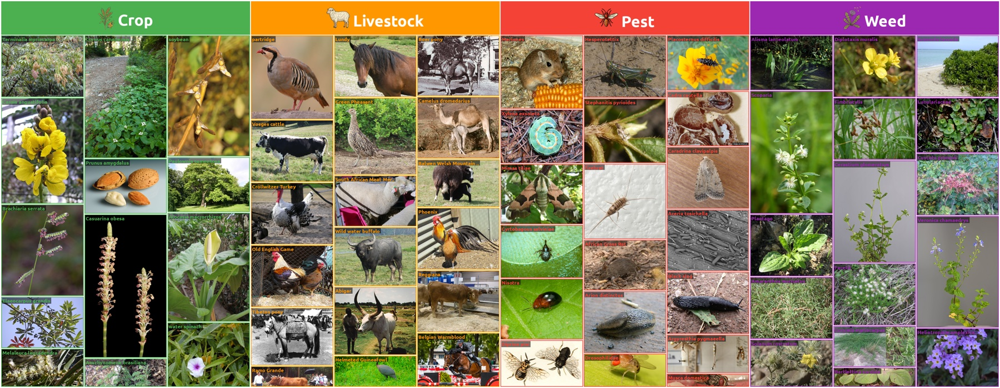

# AgriTaxon

**AgriTaxon: Knowledge-grounded benchmarking of open-ended agricultural entity naming with multimodal foundation models**

Xin Zeng, Benfeng Xu, Qian Chen, Jialin Kuai, Wentao Zhang, Liguo Lang, Shancheng Fang, Huarui Wu

<p align="center">
  
</p>

Naming the organism in an image is the entry point to many precision- and smart-farming decisions, from pesticide selection and quarantine inspection to crop verification and breed management. A wrong name can send the downstream decision to the wrong organism. **AgriTaxon** evaluates whether multimodal foundation models can produce an agricultural entity name without relying on a predefined label set.

We call this task **open-ended taxonomic naming**, using the term operationally to cover recognized organism names and, for the Livestock track, recognized breed names. It requires both visual discrimination and access to scientific names, common names, aliases, and biological relationships.

Each core sample pairs an image with machine-readable identifiers, a canonical name, collected aliases, a domain label, and an executable evaluation protocol. Wikidata connects the samples to FAO Ecocrop, FAO DAD-IS, or the EPPO Global Database.

## Benchmark Suite

| Dataset | Purpose | Entities | Images |
|---|---|---:|---:|
| **AgriTaxon Core** | Broad agricultural entity naming | 7,432 | 7,432 |
| **AgriTaxon-Hard** | Performance-conditioned diagnostic stress test | 1,052 | 1,052 |
| **AgriTaxon-Wild** | Field-condition evaluation | 2,969 | 14,845 |

The core benchmark spans four agricultural domains:

| Track | Entities | Authority source |
|---|---:|---|
| Crops | 1,971 | FAO Ecocrop |
| Livestock | 178 | FAO DAD-IS |
| Pests | 3,485 | EPPO Global Database |
| Weeds | 1,798 | EPPO Global Database |

AgriTaxon-Hard contains core samples answered correctly by at most two of the 14 evaluated models under the default multiple-choice protocol. It is intentionally performance-conditioned and is intended for failure analysis and tool-assisted recovery, not as an estimate of average benchmark performance.

AgriTaxon-Wild aligns core entities to iNaturalist taxa strictly through Wikidata P3151, without fuzzy name matching. It provides five research-grade field photographs per aligned entity and supports multi-image evaluation with K ∈ {1, 3, 5}.

## Evaluation

AgriTaxon compares:

- **Multiple-choice recognition:** one correct entity name and three text-semantically similar distractors.
- **Open-ended naming:** the model produces the entity name without candidate options.

Open-ended outputs are scored using strict exact match (OE-EM) and alias-aware accuracy (OE-Acc). Alias validation uses GPT-5 Mini and agrees with a domain expert on 98% of 100 sampled EM-error cases.

For the core benchmark, MC accuracy, OE-EM, and OE-Acc summary scores are unweighted macro-averages across the four tracks. Each track therefore contributes equally regardless of its number of samples.

Among the 14 evaluated models, the best macro-averaged scores are 83.0% for multiple-choice accuracy, 44.2% for OE-EM, and 51.2% for OE-Acc. AgriTaxon-Wild shows that multiple corroborating field views improve both candidate selection and naming, while a substantial seeing-without-naming gap remains. On AgriTaxon-Hard, cropping raises Claude Haiku 4.5 accuracy from 4.7% to 10.4%, and web retrieval raises GPT-5 Mini accuracy from 7.7% to 13.1%.

## Dataset

The complete benchmark suite is hosted on Hugging Face:

🔗 [Xin1818/AgriTaxon](https://huggingface.co/datasets/Xin1818/AgriTaxon)

```bash
pip install huggingface_hub
huggingface-cli download Xin1818/AgriTaxon --repo-type dataset --local-dir AgriTaxon
```

## Implications for Precision and Smart Farming

- **Agricultural decision support** — testing the recognition step that precedes pesticide selection, breed management, quarantine, monitoring, and yield-related decisions.
- **Long-tail reliability** — studying why globally obscure but locally important entities are named least reliably.
- **Multi-image field recognition** — aggregating independent field observations to reduce ambiguity from viewpoint, occlusion, lighting, and life stage.
- **Structured retrieval** — using FAO, EPPO, and Wikidata identifiers as traceable knowledge anchors.
- **Tool-augmented recognition** — using cropping for missing visual detail and web search for missing external knowledge.
- **Operational agricultural AI** — supporting pest surveillance, quarantine inspection, crop verification, biodiversity monitoring, and livestock breed identification.

## Supplementary Material

Prompt templates, API cost details, resolution analysis, tool specifications, error examples, and AgriTaxon-Wild per-track results are available on the [Supplementary Material](https://studyzx.github.io/AgriTaxon/supplementary.html) page.

The exact evaluation prompts are provided as raw files in [`prompts/`](prompts/). These files preserve the prompts used in the reported experiments.

## Licensing and Access

- **Source code, prompt templates, and documentation:** [MIT License](LICENSE).
- **Benchmark annotations and metadata:** CC BY 4.0.
- **Core images:** sourced from Wikimedia Commons and subject to their original licenses.
- **AgriTaxon-Wild images:** sourced from iNaturalist and subject to their per-photo licenses and attribution requirements; some licenses include NonCommercial or NoDerivatives restrictions.
- **Authority identifiers:** Wikidata QIDs are available under CC0; FAO and EPPO identifiers are used for reference linking only.

Users must consult the per-image license and attribution metadata distributed with the dataset before reuse.
